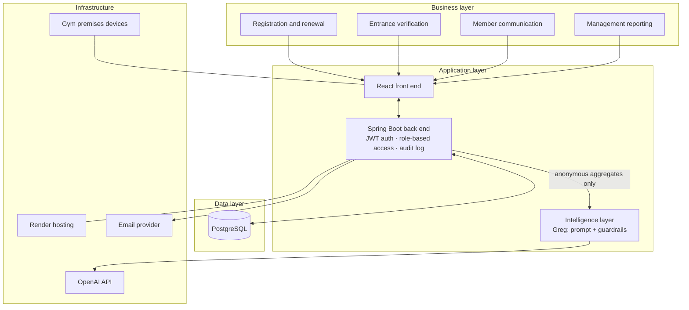

# UWC Gym Management System: project showcase

A web-based membership, access-control and reporting system built by a five-person student team for the UWC Main Campus Gym, including an admin-only AI reporting assistant ("Greg the Gym Guru") that works from anonymised aggregates only.

> **This is a documentation-only showcase.** The source code is not published: it was written by a team for a real client and the deployed system holds real member data. There is no public demo link for the same reason. Screenshots here use fictional data. A private walkthrough is available on request.

## The problem
Before digitisation, a member paid at the cashier, took the receipt to the gym, filled in a paper contract and had the expiry date written down by staff, then was registered on the QuickTag card system for entrance. Renewal meant repeating all of it. When a card failed at the door, staff could not always find the paper contract, and reporting meant digging through paper.

## What the system does
* **Member and contract records** that can be searched by authorised staff, with contract history instead of paper
* **Registration preview and confirmation** step to catch errors before a record is saved
* **Controlled corrections** by authorised staff, with an audit trail
* **Attendance, streaks and accountability groups**, including rest-day handling
* **Access decisions** (allowed / warning / denied) that record attendance correctly
* **Contract-expiry notifications** and administrative email
* **Analytics dashboards** for attendance, membership, contract duration and finances, with CSV export and print
* **Greg the Gym Guru**: turns analytics into a management report (below)

## The AI feature: Greg
An admin picks a report focus, audience, tone, length and period (optionally compared with the previous equivalent period). The backend calculates every figure, then asks an OpenAI model only to write the narrative.

Design rules (see [`docs/greg-guardrails.md`](docs/greg-guardrails.md)):
* the model only ever receives **allow-listed, anonymous aggregates**: no names, ID numbers, contact details or individual visit histories
* **small groups are suppressed** so individuals can't be inferred
* numbers come from the backend, not the model; **estimates are labelled as estimates**
* output that cites metrics it wasn't given, or is malformed, is **rejected** and the normal report is shown instead
* access is enforced **on the server by role**, not by hiding buttons in the UI
* the AI explains and suggests; it cannot approve access, suspend anyone or edit a contract or membership

## Architecture

More detail in [`docs/architecture.md`](docs/architecture.md).

## Built for South African conditions
Loadshedding, patchy connectivity, data costs and phone-first users shaped the design. Details in [`docs/architecture.md`](docs/architecture.md#south-african-constraints-and-mitigations).

## Inclusive design
* Simple, large-icon, responsive layouts so staff and members can use a phone instead of needing a laptop
* An inclusive range of gender-identity options on member records

## Testing and security
The team ran a documented audit across ten areas (access control, privacy, report accuracy, data leaving the system, password reset, concurrent check-ins, access decisions, record integrity, notifications and audit-failure containment). Summary in [`docs/greg-guardrails.md`](docs/greg-guardrails.md#audit-results-as-reported-by-the-team).

## Tech stack
Java · Spring Boot · React · PostgreSQL · JWT · BCrypt · OpenAI API · Render · transactional email service

## My contribution
I was responsible for the project's ethical considerations. I implemented the ethics framework in the team's final submission, which covers:

* **Purpose limitation and data minimisation:** only aggregated data reaches the AI model, with no names, ID numbers, contact details or individual visit histories
* **Privacy and authorisation:** access rules enforced in the back end by role (JWT, BCrypt, role separation), not just by hiding features in the UI
* **Accuracy, transparency and accountability:** figures computed by the back end, reporting periods stated, verified facts separated from AI interpretation, no predictions when data is insufficient
* **Human oversight:** the AI cannot approve access, suspend a member or change a contract or membership record
* **Security and retention:** API keys kept server-side, and retention and deletion following institutional and legal requirements
* **Consent and accessibility:** client permission for live demos, fictional or anonymised data for testing, and usability testing of the simplified interface

These principles line up with the guardrails documented in [`docs/greg-guardrails.md`](docs/greg-guardrails.md).
## What is not in this repo, and why
Source code, database contents, live credentials, the deployed URL and interview material are deliberately omitted to protect member privacy and the client. Anything shown here is documentation or fictional.

## Project context
Built for the University of the Western Cape, module IFS 317 (2026), with the UWC Main Campus Gym as the real client.

## AI-use note
The AI reporting feature uses OpenAI models inside the product. This showcase documentation was drafted with Claude (Anthropic) from the team's own course submissions and reviewed by the author.

## Author
Ivokuhle Uyanda Xali · [Portfolio](https://ivokuhle.github.io/ivokuhlexali-portfolio/) · [LinkedIn](https://linkedin.com/in/ivokuhle-xali) · [GitHub](https://github.com/Ivokuhle)
